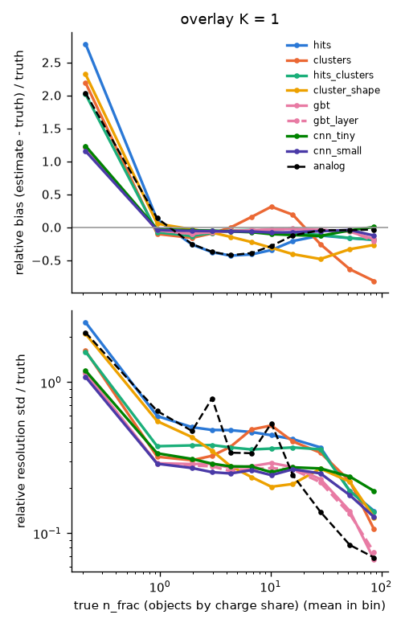
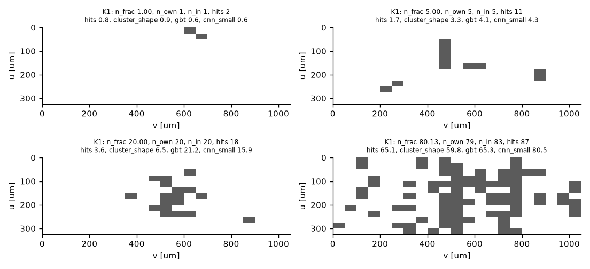
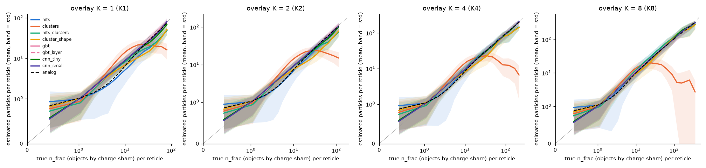
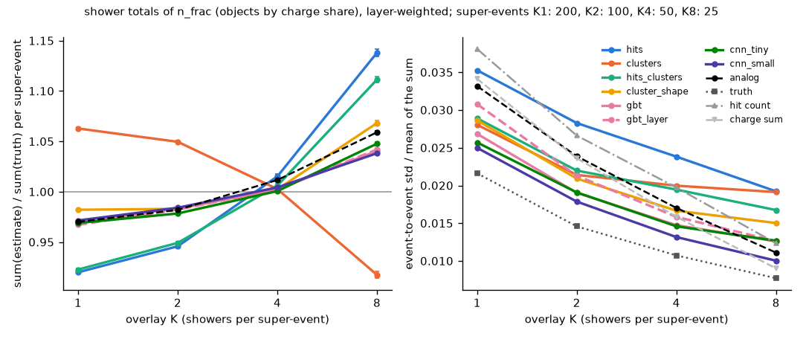

# Counting particles per reticle from the hit map

A digital calorimeter with 50 x 25 um pixels makes far more hits than it can send off the
detector. What the energy measurement needs is much smaller: the number of charged particles
that crossed each sensor layer. This note asks whether logic at the edge of a sensor could turn
the hit map of one reticle (a fixed block of pixels) into that number, so that the detector
sends one count per reticle and not its pixels, and what is lost by doing so.

It is a simulation study on 200 photon showers of 50 GeV in the 100 um silicon variant, with
PIXELAV transporting the charge. Section 8 lists what it does not cover; those limits matter.

**Short version**

- In single showers a count per reticle made from the binary hit map alone reproduces the true
  number of crossings to 0.28 (rms) where the reticle holds one crossing and to about 30% of the
  truth up to 20 crossings per reticle.
- Summed over a shower with the layer weights, the true number of crossings varies by
  2.2% from shower to shower. The raw hit count varies by 3.8%, the collected charge by 3.4%,
  and the count estimated per reticle from binary maps by 2.5 to 2.8% (trees, small network,
  cluster count). Counting at the edge keeps most of what separates particle counting from hit
  counting.
- Binary maps saturate. Above about 20 crossings per reticle the hit pixels merge. At the
  density of eight overlaid showers the best binary estimator is then 1.9 to 2.8 times worse
  than the small network on the full charge (1.4 to 1.5 times in single showers). With the same
  network, a 2-bit charge per pixel recovers about 80% of that gap up to 80 crossings.
- A count takes 8 bits per reticle against 273 for the bitmap and 51 on average for
  zero-suppressed hit addresses (the address of the reticle itself not counted, in any of the
  three). Eight bits are enough for single showers, not for the densest cores (section 6.7).
- An estimator calibrated on one mix of densities is off by several percent on another. Between
  single showers and eight overlaid showers the best binary ones move by 7%, the simple tables by
  9 to 22%, the 2-bit ones by 2%. Along the depth of a shower the hit-count table goes from 28%
  low in the first layers to 12% high in the last; the trees stay within 1% from layer 5 on.

---

## 1. The chain

```
ddsim, per-step deposits     sim/make_pixelav_inputs.sh      (CALOMAPS_PIXELAV_ROUTE=deposits)
  -> deposit jobs            analysis/pixelav/deposit_jobs.py
  -> charge transport        analysis/pixelav/run_deposit_jobs.sh   (ppixelav2_inject_deposits)
  -> charge per pixel        analysis/pixelav/charge_maps.py
  -> reticles + truth        analysis/pixelav/reticles.py
  -> counts                  analysis/pixelav/mip_counting.py, mip_counting_cnn.py
```

The first four steps are the deposits route of [`pixelav_handoff.md`](pixelav_handoff.md)
(sections 2, 4 and 5.3): Geant4 writes every step in the silicon, PIXELAV drifts the charge of
each step to the pixels. The formats are in [`pixelav_reference.md`](pixelav_reference.md)
(sections 3c and 6). This note covers the last two steps.

## 2. The sample

- 200 showers of 50 GeV photons, in 10 batches of 20 events with simulation seeds 424242,
  425242, ..., 433242.
- Silicon 100 um thick (`CALOMAPS_SI_THICKNESS_UM=100`), production cut 1 um and step limit 5 um
  in the silicon, so delta rays are explicit.
- Sensor model: the CMS barrel pixel 100 um, 50 x 25 um field map, used as a stand-in for a
  DECAL sensor that has no field map yet. No magnetic field.
- Per batch the pairs made equal the deposited energy / 3.68 eV and no pair fell outside its
  job window. In total 1.33e10 electrons, 66 million per shower.
- 642,082 particle-plane groups, 805,355 crossings above 1000 e (the counting target), and
  600,628 reticles of 21 x 13 pixels holding charge, about 3,000 per shower.

A reticle here is 21 x 13 pixels, 1.05 x 0.325 mm, the PIXELAV output window. The grid is placed
so that the shower axis falls near the centre of one reticle (`--offset-x 10 --offset-y 6`).

**Density.** Single 50 GeV showers are sparse almost everywhere:

| crossings in the reticle | 0 | 1 | 2 to 5 | 6 to 20 | above 20 |
|---|---|---|---|---|---|
| share of the reticles holding charge | 25.7% | 57.0% | 14.7% | 2.2% | 0.47% |
| share of all crossings | 4.1% | 40.1% | 28.2% | 15.1% | 12.5% |

("0": the shares of crossings in the reticle, as defined in section 3, add to less than one
half. The tables of section 6 leave this column out.) The densest reticle
holds 96 crossings in about 80 hit pixels. To reach the densities of a higher-energy core, K showers
are summed plane by plane (`reticles.py --overlay K`); PIXELAV's carriers do not interact, so
the sum is exact.
With K = 8 the share of crossings in reticles above 20 rises to 35% and the densest reticle
holds 441. An overlay of K showers of 50 GeV is not a shower of K x 50 GeV (its core is wider
and its depth profile is that of 50 GeV); it is a way to dial the density, nothing more.

## 3. What is counted

The truth object is a **crossing**: the connected footprint that one charged particle, with the
delta rays it made in the slab, leaves on one sensor plane. A particle is not always one
crossing. 16.6% of the particles above 1000 e cross the same plane more than once (soft electrons
and positrons, median 3.9 MeV/c, scattered out of the silicon and back); their two footprints
sit a median of 1.7 mm apart, and no counter looking at pixels could tell them from two
particles. `reticles.py --truth crossings` (the default) splits each particle's pixels into such
islands; `--truth particles` keeps one object per particle.

A crossing reaches 1.3 reticles on average, so the count per reticle needs a rule for crossings
on an edge. Three are computed (cut: charge above the pixel threshold):

- `n_frac` (the target used below): each crossing is shared among the reticles it touches in
  proportion to its charge there. It sums exactly to the number of crossings on the plane, and
  stays additive when reticles are merged.
- `n_own`: each crossing counts once, in the reticle holding most of its charge.
- `n_in`: a crossing counts in every reticle where its share exceeds the cut (an edge crossing
  counts twice).

## 4. The readout

Each pixel gets Gaussian noise of 100 e and a threshold of 1000 e; the estimators see the
binary map. Two richer readouts are run for comparison: a 2-bit charge per pixel (`tot2`:
how many of the levels 1, 4 and 16 times the threshold the charge exceeds) and the full charge
(`analog`), which an edge circuit would not have.

## 5. The estimators

| name | input | what it is |
|---|---|---|
| `hits` | binary | table: mean count for each number of hit pixels |
| `clusters` | binary | table: mean count for each number of 8-connected clusters |
| `hits_clusters` | binary | table in both |
| `cluster_shape` | binary | per cluster, a table in (size, width, height), summed over the clusters |
| `gbt` | binary | gradient-boosted trees (300) on 15 reticle summaries (hits, clusters, clusters per size class, edge hits and clusters, largest cluster, rows and columns hit) and the hits per row and per column |
| `cnn_tiny` | binary | convolutional network, 3 layers of 8 channels, 1,257 parameters |
| `cnn_small` | binary | convolutional network, 4 layers of 16 to 32 channels, 23,329 parameters |
| `cnn_*_tot2` | 2-bit | the same networks on the 2-bit charge |
| `cnn_*_analog` | charge | the same on the full charge (reference) |
| `analog` | charge | table: mean count for each total charge of the reticle (reference) |

The networks end in a non-negative number per pixel, and the count is their sum; the same
weights therefore serve any reticle size. Everything is cross-fitted in 5 blocks of events: a
reticle is always estimated by a model that never saw its shower.

## 6. Results

Unless said otherwise: target `n_frac`, 21 x 13 reticles, threshold 1000 e, noise 100 e, rms of
(estimate - truth) over the reticles whose truth rounds to the bin.

### 6.1 Per reticle, single showers

Trained and evaluated on single showers (K = 1):

| estimator | input | 1 | 2 | 3 | 4 to 5 | 6 to 8 | 9 to 12 | 13 to 20 | 21 to 40 | 41 to 80 |
|---|---|---|---|---|---|---|---|---|---|---|
| *reticles* | | *342,325* | *54,697* | *18,765* | *14,931* | *7,273* | *3,099* | *2,592* | *1,881* | *912* |
| `hits` | binary | 0.57 | 1.10 | 1.81 | 2.79 | 4.18 | 5.72 | 7.43 | 10.99 | 13.01 |
| `clusters` | binary | 0.32 | 0.67 | 1.00 | 1.62 | 3.44 | 6.13 | 7.11 | 12.00 | 34.87 |
| `hits_clusters` | binary | 0.36 | 0.79 | 1.16 | 1.61 | 2.42 | 3.76 | 6.06 | 10.60 | 12.96 |
| `cluster_shape` | binary | 0.52 | 0.84 | 1.06 | 1.36 | 2.18 | 3.76 | 7.28 | 15.48 | 20.62 |
| `gbt` | binary | 0.28 | 0.59 | 0.88 | 1.20 | 1.89 | 2.98 | 4.37 | 6.52 | 8.03 |
| `cnn_tiny` | binary | 0.32 | 0.61 | 0.87 | 1.23 | 1.92 | 2.78 | 4.72 | 8.39 | 12.53 |
| `cnn_small` | binary | 0.27 | 0.54 | 0.77 | 1.11 | 1.81 | 2.59 | 4.37 | 7.20 | 9.50 |
| `cnn_tiny_tot2` | 2-bit | 0.31 | 0.57 | 0.78 | 1.12 | 1.71 | 2.54 | 3.95 | 7.43 | 14.63 |
| `cnn_small_tot2` | 2-bit | 0.26 | 0.50 | 0.70 | 1.00 | 1.54 | 2.21 | 3.28 | 4.85 | 6.59 |
| `cnn_tiny_analog` | charge | 0.30 | 0.53 | 0.75 | 1.08 | 1.66 | 2.48 | 3.80 | 6.07 | 8.92 |
| `cnn_small_analog` | charge | 0.25 | 0.47 | 0.67 | 0.95 | 1.46 | 2.09 | 3.10 | 4.29 | 5.62 |
| `analog` (charge sum) | charge | 0.62 | 1.05 | 2.56 | 2.35 | 3.47 | 6.13 | 4.31 | 4.09 | 4.87 |

- With one crossing in the reticle the hit count alone is off by 0.57: a single crossing lights
  1 to 12 pixels (5th to 95th percentile, median 3; from its angle, its delta rays, and
  crossings shared with a neighbouring reticle). Counting clusters
  brings that to 0.32, and shape information to 0.27 (`cnn_small`) or 0.28 (`gbt`).
- The cluster count is the best table up to 3 crossings. Beyond that clusters merge: it is
  biased high around 10 to 20 (+3) and collapses above 20 (-7 at 21 to 40, -33 at 41 to 80).
- The tree model and the small network are close to each other on binary maps. The mean of
  (estimate - truth) stays within 0.4 crossings up to 20 for the trees and within 1.2 for the
  network; at 41 to 80 they are low by 3.4 and 2.1.
- From 13 crossings up the total charge of the reticle, through a plain table, is as good as or
  better than any binary estimator (4.3 against 4.4 at 13 to 20, 4.1 against 6.5 at 21 to 40).
  Below that it is about as good as the hit-count table: the charge of one crossing ranges
  from about 6,600 to 34,000 e (10th to 90th percentile).



*Single showers: mean of (estimate - truth) / truth (top) and standard deviation of the
estimate / truth (bottom, not the rms of the tables) against the true count. The leftmost point
is the "0" column of section 2. `gbt_layer` is `gbt` with the layer number as an extra input
(section 6.2). The networks on 2-bit and full charge are not drawn.*



*Hit maps of four reticles with 1, 5, 20 and 80 crossings. Each title gives the three truths
of section 3, the number of hit pixels, and four estimates of `n_frac`.*

### 6.2 Shower totals

The calorimeter uses the sum over the shower. The barrel has 20 layers behind 2.5 mm of tungsten
and 10 behind 5 mm, so the sum weighs the last 10 layers twice (`--layer-weights 20:2`; without
weights the spread is 7%, set by how deep the shower develops and not by the counting).
Event-to-event spread (std / mean) of the weighted total over the 200 showers:

| total of | input | spread, weighted | spread, unweighted | estimate / truth (weighted): mean ± spread over showers |
|---|---|---|---|---|
| true crossings | | 2.2% | 7.0% | |
| hit pixels | binary | 3.8% | 8.2% | |
| charge | charge | 3.4% | 7.8% | |
| `hits` | binary | 3.9% | 8.5% | 1.012 ± 0.027 |
| `clusters` | binary | 2.8% | 7.3% | 1.000 ± 0.017 |
| `hits_clusters` | binary | 3.3% | 8.0% | 0.999 ± 0.019 |
| `cluster_shape` | binary | 3.0% | 7.7% | 1.011 ± 0.016 |
| `gbt` | binary | 2.6% | 7.3% | 0.999 ± 0.011 |
| `cnn_tiny` | binary | 2.7% | 7.5% | 1.002 ± 0.013 |
| `cnn_small` | binary | 2.5% | 7.3% | 1.000 ± 0.010 |
| `cnn_tiny_tot2` | 2-bit | 2.6% | 7.2% | 0.999 ± 0.013 |
| `cnn_small_tot2` | 2-bit | 2.4% | 7.2% | 1.000 ± 0.008 |
| `cnn_tiny_analog` | charge | 2.5% | 7.2% | 1.002 ± 0.010 |
| `cnn_small_analog` | charge | 2.3% | 7.1% | 0.999 ± 0.007 |
| `analog` (charge sum) | charge | 3.3% | 7.7% | 1.012 ± 0.022 |

The estimated totals track the truth shower by shower: the ratio estimate / truth has a spread
over the showers (the ± of the last column, not an error) of 1.0 to 1.3% for the trees and the
binary networks, 1.7% for the cluster count and 2.7% for the hit-count table. The mean of that
ratio is known to 0.1 to 0.2%, so the offsets of `hits`, `cluster_shape` and the charge sum
(+1.1 to +1.2%) are real. Without the layer weights every estimator gives 0.998 (the missing
0.2% are crossings in reticles without a hit): one table serves all layers, and the weighted
sum leans on the last ten, where the same hit pattern stands for fewer crossings (section 6.4). Rounding the estimate of each reticle to an 8-bit number in steps of 0.25
(largest value 63.75) barely changes the spread (2.60% to 2.62% for `gbt`); steps of 1 give 2.67%
and shift the scale by 5%.

Giving the trees the layer number (`gbt_layer`) improves the rms per reticle a little (4.2
against 4.4 at 13 to 20 crossings) and makes the shower total worse (2.9% against 2.6%, a
difference of 0.32 ± 0.06 points). A likely reason: the layer works as a prior on the density,
set by the average shower, and a shower that starts early or late does not follow it.

These spreads compare readouts on the same showers. They are not the resolution of the
calorimeter: 100 um silicon, one energy, 200 showers, and no calibration beyond the two weights.
Each spread has a statistical error of 5% of its value. The rows share the showers, so
differences are known better; from a bootstrap over the showers, in percentage points: `gbt`
minus truth 0.44 ± 0.07, hit count minus `gbt` 1.21 ± 0.15, charge minus `gbt` 0.81 ± 0.14,
cluster count minus `gbt` 0.22 ± 0.10. The order truth, estimated counts, charge, hits is
established. Differences of 0.1 to 0.2 points among the estimators are not.

### 6.3 Denser cores

Trained on the mix of K = 1, 2, 4, 8 and evaluated at each K. Rms per reticle at K = 8:

| estimator | input | 1 | 2 | 3 | 4 to 5 | 6 to 8 | 9 to 12 | 13 to 20 | 21 to 40 | 41 to 80 | above 80 |
|---|---|---|---|---|---|---|---|---|---|---|---|
| *reticles* | | *190,346* | *36,902* | *14,328* | *12,661* | *7,807* | *4,424* | *3,629* | *3,128* | *867* | *841* |
| `hits` | binary | 0.61 | 1.27 | 2.03 | 2.91 | 4.18 | 5.95 | 8.09 | 12.78 | 25.23 | 64.15 |
| `clusters` | binary | 0.42 | 0.97 | 1.65 | 2.86 | 4.86 | 6.59 | 6.49 | 12.13 | 41.15 | 193.00 |
| `hits_clusters` | binary | 0.38 | 0.86 | 1.32 | 1.94 | 3.14 | 5.19 | 7.68 | 12.74 | 24.98 | 63.91 |
| `cluster_shape` | binary | 0.54 | 0.93 | 1.32 | 1.71 | 2.55 | 4.08 | 6.22 | 12.29 | 24.79 | 65.26 |
| `gbt` | binary | 0.31 | 0.68 | 1.05 | 1.51 | 2.42 | 3.72 | 5.52 | 8.21 | 15.22 | 39.58 |
| `cnn_tiny` | binary | 0.36 | 0.68 | 1.00 | 1.41 | 2.18 | 3.20 | 5.01 | 8.42 | 16.69 | 48.06 |
| `cnn_small` | binary | 0.30 | 0.58 | 0.87 | 1.23 | 1.91 | 2.92 | 4.73 | 8.27 | 15.40 | 39.36 |
| `cnn_tiny_tot2` | 2-bit | 0.38 | 0.67 | 0.93 | 1.26 | 1.81 | 2.53 | 3.72 | 5.93 | 10.58 | 29.10 |
| `cnn_small_tot2` | 2-bit | 0.30 | 0.56 | 0.81 | 1.10 | 1.63 | 2.25 | 3.32 | 5.02 | 7.94 | 24.39 |
| `cnn_tiny_analog` | charge | 0.33 | 0.61 | 0.86 | 1.16 | 1.67 | 2.32 | 3.40 | 5.30 | 8.52 | 19.62 |
| `cnn_small_analog` | charge | 0.28 | 0.53 | 0.76 | 1.03 | 1.53 | 2.13 | 3.06 | 4.41 | 6.24 | 14.02 |
| `analog` (charge sum) | charge | 0.69 | 1.08 | 1.89 | 2.34 | 4.28 | 3.78 | 4.35 | 5.95 | 11.21 | 13.84 |

- Binary maps saturate. A crossing lights 4 pixels on average, but in single showers the
  reticles with 21 to 40 crossings (mean 28) show 43 hit pixels and those with 41 to 80 (mean 52)
  show 61: 1.5 and 1.2 pixels per crossing. Above 20 crossings the best binary estimator is 1.9
  (21 to 40), 2.4 (41 to 80) and 2.8 (above 80) times worse than the network on the full charge.
- Two bits of charge per pixel, with the same network, recover 84%, 81% and 59% of that gap in
  the three bins.
- The plain charge sum beats every binary estimator from 13 crossings up, stays behind the 2-bit
  network up to 80, and equals the charge network above 80. Below 9 it does about as badly as
  the hit-count table.
- For the trees and the networks the numbers at low counts are close to those of single
  showers (0.31 against 0.28 for `gbt` at one crossing): the overlay adds dense reticles without
  spoiling the sparse ones. The tables suffer more (`clusters` at one crossing: 0.42 at K = 8
  against 0.35 at K = 1, both from the mix-trained table).



*Mean estimate against the true count for K = 1, 2, 4, 8, models trained on the mix; the bands
are the standard deviation. The networks on 2-bit and full charge are not drawn.*

### 6.4 A calibration is tied to its density mix

A table or a model fitted on one mix of densities carries that mix as a prior. Ratio of the
estimated to the true weighted shower total, for models trained on the mix of all K:

| estimator | input | K = 1 | K = 2 | K = 4 | K = 8 |
|---|---|---|---|---|---|
| `hits` | binary | 0.920 | 0.946 | 1.015 | 1.138 |
| `clusters` | binary | 1.063 | 1.050 | 1.003 | 0.917 |
| `hits_clusters` | binary | 0.923 | 0.949 | 1.006 | 1.111 |
| `cluster_shape` | binary | 0.982 | 0.983 | 1.002 | 1.068 |
| `gbt` | binary | 0.969 | 0.984 | 1.003 | 1.041 |
| `cnn_tiny` | binary | 0.969 | 0.978 | 1.001 | 1.048 |
| `cnn_small` | binary | 0.972 | 0.984 | 1.004 | 1.038 |
| `cnn_tiny_tot2` | 2-bit | 0.992 | 0.997 | 1.002 | 1.011 |
| `cnn_small_tot2` | 2-bit | 0.989 | 0.997 | 1.002 | 1.011 |
| `cnn_tiny_analog` | charge | 0.991 | 0.998 | 1.004 | 1.011 |
| `cnn_small_analog` | charge | 0.989 | 0.996 | 1.002 | 1.010 |
| `analog` (charge sum) | charge | 0.970 | 0.982 | 1.012 | 1.059 |

Trained on K <= 2 and applied to K = 4 and 8, never seen in training:

| estimator | input | K = 4 | K = 8 |
|---|---|---|---|
| `hits` | binary | 1.140 | 1.274 |
| `clusters` | binary | 0.949 | 0.866 |
| `hits_clusters` | binary | 1.117 | 1.238 |
| `cluster_shape` | binary | 1.045 | 1.106 |
| `gbt` | binary | 1.024 | 1.044 |
| `cnn_tiny` | binary | 1.043 | 1.097 |
| `cnn_small` | binary | 1.032 | 1.071 |
| `cnn_tiny_tot2` | 2-bit | 1.004 | 1.007 |
| `cnn_small_tot2` | 2-bit | 0.999 | 0.991 |
| `cnn_tiny_analog` | charge | 1.003 | 1.008 |
| `cnn_small_analog` | charge | 0.999 | 0.995 |
| `analog` (charge sum) | charge | 1.056 | 1.112 |

The binary estimators need a calibration matched to the density they will see: trained on the
mix, `gbt` is 3% low on single showers and 4% high at K = 8, and trained on K <= 2 it is 4% high
at K = 8 (the hit-count table 27%). The layer number as an extra input does not help here
(`gbt_layer`: 0.967 at K = 1, 1.042 at K = 8). The 2-bit networks carry over to densities they
never saw to within 1%.

The same holds along the depth of one shower. Hit pixels per crossing rise from 2.9 in the
first five layers to 4.7 in the last ten, so one calibration for all layers is wrong layer by
layer. Estimated over true number of crossings in groups of layers, single showers:

| layers | 0 to 4 | 5 to 9 | 10 to 14 | 15 to 19 | 20 to 29 |
|---|---|---|---|---|---|
| *share of the crossings* | *3.1%* | *21.4%* | *35.5%* | *27.9%* | *12.0%* |
| *hit pixels per crossing* | *2.9* | *3.5* | *4.0* | *4.4* | *4.7* |
| `hits` | 0.72 | 0.95 | 1.00 | 1.01 | 1.12 |
| `clusters` | 0.72 | 0.92 | 1.03 | 1.04 | 1.01 |
| `gbt` | 0.89 | 0.99 | 1.01 | 1.00 | 1.01 |
| `gbt_layer` | 0.99 | 1.00 | 1.00 | 1.00 | 1.00 |

The hit-count table is 28% low at the front and 12% high at the back. The trees are within 1%
from layer 5 on. With the layer as an input the calibration is flat, at the price of the larger
spread of the total (section 6.2). The networks were not checked by layer.



*Models trained on the mix. Left: estimated over true weighted total. Right: spread of the
weighted total over the super-events. A super-event sums K showers, so every spread falls about
as 1/sqrt(K) (the truth: 2.2, 1.5, 1.1, 0.8%); only the order of the curves at one K carries
information. There are 200, 100, 50 and 25 super-events, so the points at K = 8 are known to
14%.*

### 6.5 Threshold and noise

Single showers, the four table estimators, thresholds 500 to 4000 e and noise 0 to 200 e. The
truth is the same at every point (crossings above 1000 e); only the readout changes. Rms per
reticle in groups of the true count, and the estimated over the true shower total (unweighted),
at 100 e noise:

| threshold | estimated / true total | `clusters`, 1 to 3 | `hits_clusters`, 4 to 12 | `hits`, 41 and above |
|---|---|---|---|---|
| 500 e | 0.999 | 0.42 | 2.28 | 13.9 |
| 1000 e | 0.998 | 0.43 | 2.23 | 13.1 |
| 2000 e | 0.989 | 0.60 | 2.35 | 10.7 |
| 4000 e | 0.867 | 0.72 | 2.09 | 7.9 |

- 500 and 1000 e are equivalent.
- A higher threshold trades the sparse region against the dense one. At 2000 e the cluster
  count in sparse reticles degrades (0.43 to 0.60: clusters break up) and 0.7% of the crossings
  sit in reticles without any hit (0.2% at 1000 e). The dense reticles improve (13.1 to 10.7
  above 40 crossings), because fewer pixels fire per crossing and the map saturates later.
- At 4000 e, 12.5% of the crossings sit in reticles without any hit and the total comes out 13%
  low: in 100 um of silicon a crossing makes 10,000 e (median), shared among the pixels it
  passes. The threshold has to stay at or below about 2000 e for this thickness and pitch.
- From 1000 e up, noise up to 200 e matters only through fake hits in empty reticles. At 1000 e
  and 100 e noise (10 sigma) none appeared in 20,000 pure-noise reticles. At 5 sigma (1000 e
  with 200 e noise, or 500 e with 100 e) the Gaussian tail gives 8 noise hits per shower in
  the 108,000 empty reticles within 20 mm of the axis, counted as 5 to 12 fake crossings
  depending on the table, against 4,000 true ones.
- At 500 e and 200 e noise (2.5 sigma) an empty reticle holds 1.7 fake hits, read as 0.2 to
  0.7 crossings, and the empty reticles swamp the shower. The reticles with charge suffer too
  (`clusters` at 1 to 3 crossings: 0.42 to 0.75).

### 6.6 Reticle size

With reticles of 42 x 26 pixels (2.1 x 0.65 mm) on the same showers:

| estimator | input | 1 | 2 | 3 | 4 to 5 | 6 to 8 | 9 to 12 | 13 to 20 | 21 to 40 | 41 to 80 |
|---|---|---|---|---|---|---|---|---|---|---|
| *reticles* | | *214,772* | *48,848* | *17,345* | *14,716* | *8,801* | *5,199* | *3,790* | *2,689* | *1,752* |
| `hits` | binary | 0.82 | 1.18 | 1.83 | 2.67 | 4.00 | 5.65 | 7.58 | 11.55 | 16.18 |
| `clusters` | binary | 0.32 | 0.54 | 0.78 | 1.01 | 1.50 | 2.42 | 5.15 | 12.53 | 20.79 |
| `hits_clusters` | binary | 0.43 | 0.77 | 1.22 | 1.69 | 2.35 | 3.58 | 6.09 | 10.78 | 16.13 |
| `cluster_shape` | binary | 0.77 | 0.94 | 1.27 | 1.57 | 1.77 | 2.13 | 3.82 | 10.45 | 27.14 |
| `gbt` | binary | 0.26 | 0.47 | 0.69 | 0.92 | 1.36 | 1.85 | 3.03 | 5.34 | 7.69 |
| `cnn_small` | binary | 0.28 | 0.46 | 0.63 | 0.83 | 1.27 | 1.89 | 3.02 | 6.07 | 10.43 |
| `analog` (charge sum) | charge | 0.78 | 1.15 | 1.77 | 2.39 | 4.17 | 4.23 | 4.97 | 7.36 | 6.34 |

| total of | input | spread, weighted | spread, unweighted | estimate / truth (weighted): mean ± spread over showers |
|---|---|---|---|---|
| true crossings | | 2.2% | 7.0% | |
| hit pixels | binary | 3.8% | 8.2% | |
| charge | charge | 3.4% | 7.8% | |
| `hits` | binary | 4.3% | 8.7% | 1.007 ± 0.031 |
| `clusters` | binary | 2.7% | 7.2% | 1.000 ± 0.016 |
| `hits_clusters` | binary | 3.4% | 8.1% | 0.999 ± 0.022 |
| `cluster_shape` | binary | 2.9% | 7.6% | 1.013 ± 0.017 |
| `gbt` | binary | 2.4% | 7.1% | 0.999 ± 0.010 |
| `cnn_small` | binary | 2.4% | 7.3% | 1.001 ± 0.010 |
| `analog` (charge sum) | charge | 3.5% | 7.8% | 1.008 ± 0.025 |

(`cnn_small` trained for 3000 steps here, 8000 elsewhere.) A larger reticle holds more whole
crossings, so fewer are split at an edge, and the same number of crossings is spread over 4
times the area: at 13 to 20 crossings `gbt` reaches 3.0 against 4.4. The weighted shower total
is slightly better (2.4% against 2.6% for `gbt`) with fewer counts to send (1,800 reticles with
a hit per shower against 2,860).

### 6.7 Data volume

Per reticle with at least one hit, and per shower (single showers):

| format | bits per reticle (21 x 13) | kbit per shower | bits per reticle (42 x 26) | kbit per shower |
|---|---|---|---|---|
| bitmap, 1 bit per pixel | 273 | 781 | 1092 | 1965 |
| zero-suppressed, one address per hit | 51 (mean) | 147 | 100 (mean) | 179 |
| count, 8 bits | 8 | 22.9 | 8 | 14.4 |

A count is 6 times smaller than zero-suppressed addresses and 34 times smaller than the bitmap.
The gain grows in the core, where zero suppression stops helping: above 30 hits in a 21 x 13
reticle the address list is longer than the bitmap. With K = 8 the zero-suppressed volume is
10 times that of the counts.

Two things are left out of this table.

- The address of the reticle, the same in all three formats. With 10 address bits per reticle
  the count is 3.4 times smaller than the hit addresses and 16 times smaller than the bitmap.
- The range of the count. Eight bits in steps of 0.25 reach 63.75, which loses 0.1% of the
  crossings in single showers. At K = 8, 20% of the crossings sit in reticles above that value
  and clipping would lose 12% of the total; the densest reticle holds 441. A dense core needs
  9 bits in steps of 1, or a coarser scale at high counts.

## 7. What the edge logic would have to do

- `clusters` needs connected-component labelling of a 273-pixel map and a table of a few
  dozen entries. `hits` needs a population count.
- `cnn_tiny` is 1,257 parameters and 336,000 multiply-adds per reticle (1,232 per pixel);
  `cnn_small` is 23,329 parameters and 6.3 million multiply-adds. The tot2 versions cost the
  same and need 2 bits per pixel from the front end.
- `gbt` is 300 trees of up to 31 leaves on 49 inputs. It is the software reference for what
  hand-made features can reach, not a proposal for hardware.

Nothing here was quantised, pruned or timed for a circuit.

## 8. Limits

- **One energy, one particle type.** 50 GeV photons only. The overlay dials density; it does not
  make a higher-energy shower. Hadron showers (wide-angle, heavily ionising tracks) are not
  covered.
- **Stand-in sensor.** The field map is a CMS barrel pixel sensor (100 um, 50 x 25 um, 100 V
  bias), not a DECAL MAPS pixel. Charge sharing, and with it every cluster shape here, depends
  on it.
- **Simple front end.** Gaussian noise and a fixed threshold. No threshold dispersion, no dead
  or noisy pixels, no time structure, no cross-talk.
- **One driver seed.** All 10 batches were transported with PIXELAV seed 1 and number their jobs
  from 0, so the batches reuse the same random streams for the drift (the deposits differ).
  The effect on the charges is expected to be negligible but was not measured; a rerun should
  give each batch its own seed.
- **Statistics.** 200 showers; the bins above 40 crossings hold about 900 reticles in single
  showers, 8 above 80.
- **Truth by charge share.** `n_frac` gives an edge crossing to two reticles in parts. A system
  that reads neighbouring reticles together could do better than the per-reticle numbers here.
- **The models see the training density.** Section 6.4.

## 9. Reproducing the numbers

```bash
A=analysis/pixelav
# reticles from the 10 batches of charge maps, at each overlay, and at the larger size
for K in 1 2 4 8; do
  python3 $A/reticles.py b*/pixelav_jobs_*.charges.npz --out ret_K$K.npz --overlay $K \
          --offset-x 10 --offset-y 6
done
python3 $A/reticles.py b*/pixelav_jobs_*.charges.npz --out big_K1.npz --size-x 42 --size-y 26 \
        --offset-x 10 --offset-y 6

# networks (GPU), then the tables and figures with the networks included
python3 $A/mip_counting_cnn.py ret_K1.npz --out-dir S --sizes tiny,small \
        --input binary,tot2,analog --steps 8000 --skip-extrapolation
python3 $A/mip_counting.py ret_K1.npz --out-dir S --layer-weights 20:2 \
        --include-preds S/cnn_preds.npz

python3 $A/mip_counting_cnn.py ret_K?.npz --out-dir U --sizes tiny,small \
        --input binary,tot2,analog --steps 8000
python3 $A/mip_counting.py ret_K?.npz --out-dir U --no-scan --layer-weights 20:2 \
        --include-preds U/cnn_preds.npz

python3 $A/mip_counting_cnn.py big_K1.npz --out-dir B --sizes small --input binary \
        --steps 3000 --skip-extrapolation
python3 $A/mip_counting.py big_K1.npz --out-dir B --no-scan --layer-weights 20:2 \
        --include-preds B/cnn_preds.npz
```

Sections 6.1, 6.2, 6.5 and 6.7 come from `S`, sections 6.3 and 6.4 from `U`, section 6.6 and
the 42 x 26 columns of 6.7 from `B`. `results.json` holds every number, `preds.npz` the estimate of every reticle. One training
of a network (one fold, one input) takes about 50 s (tiny) or 150 s (small) on an A100 slice,
200 s for the 42 x 26 reticles; the tables and trees run on a CPU in about 20 minutes per
directory.
`python3 $A/mip_counting.py --self-test` checks the truth definitions, the clustering and the
weighted totals on a hand-made case.
